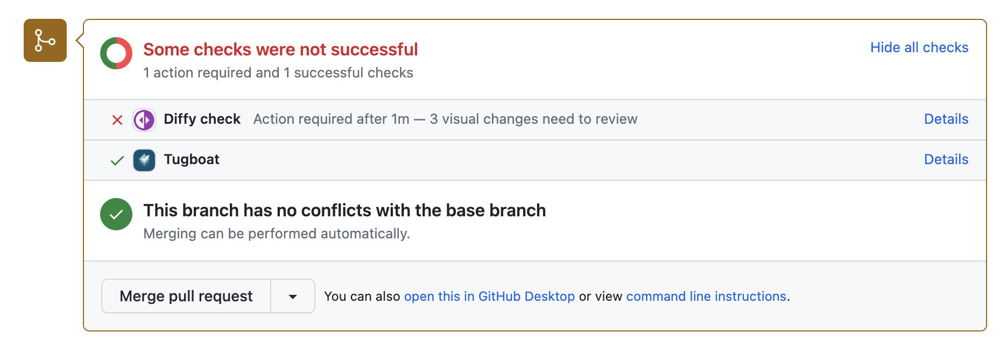

# GitHub Tugboat

Once you configured Tugboat to build your environments it is really easy to add Diffy visual testing to check those environments.

We have an example at [https://github.com/DiffyWebsite/diffy-tugboat/tree/master/.tugboat](https://github.com/DiffyWebsite/diffy-tugboat/tree/master/.tugboat)

Once you have your environment ready (after all cache rebuild, config import) you need to trigger:

```
- wget -O /usr/local/bin/diffy https://github.com/diffywebsite/diffy-cli/releases/latest/download/diffy.phar
- chmod +x /usr/local/bin/diffy
- diffy auth:login ${DIFFY_API_KEY}
- diffy project:compare ${DIFFY_PROJECT_ID} prod custom --env2Url="${TUGBOAT_SERVICE_URL}" --commit-sha=${TUGBOAT_PREVIEW_SHA}
```

For this you need to configure two Tugboat variables:

DIFFY\_API\_KEY to be generated from [https://app.diffy.website/#/keys](https://app.diffy.website/#/keys)

DIFFY\_PROJECT\_ID it is your project id. You can find it under project settings, General tab

### Diffy configuration

In order for Diffy to post results back to GitHub as a check you need to add github repo to Diffy's Project settings under Notifications / GitHub and authenticate Diffy's GitHub check by visiting [https://github.com/apps/diffy-testing](https://github.com/apps/diffy-testing)

<figure><figcaption></figcaption></figure>

