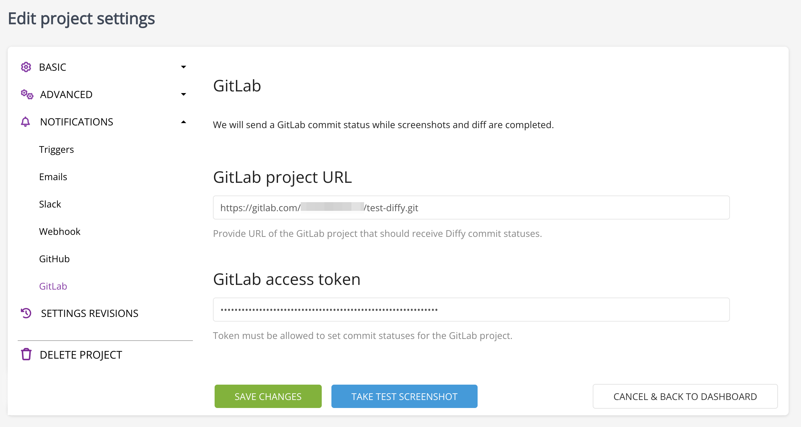

# GitLab

Diffy has GitLab integration that leverages commenting.

For example, you build test environments in your pipeline and would like to compare them with the dev environment.

Here is a snippet you can add to your pipeline:

```yaml
diffy_visual_check:
  stage: visual
  image: alpine:3.20
  needs: ["deploy_review"]

  rules:
    - if: '$CI_PIPELINE_SOURCE == "merge_request_event"'

  before_script:
    - apk add --no-cache php83 php83-phar php83-curl php83-openssl php83-json php83-iconv

  script:
    - wget -O /usr/local/bin/diffy https://github.com/diffywebsite/diffy-cli/releases/latest/download/diffy.phar
    - chmod a+x /usr/local/bin/diffy
    - diffy auth:login "$DIFFY_API_KEY"
    - >
      diffy project:compare "$DIFFY_PROJECT_ID" dev custom
      --env2Url="https://test-diffy-mr-${CI_MERGE_REQUEST_IID}.surge.sh"
      --commit-sha="$CI_COMMIT_SHA"
      --merge-request-iid="$CI_MERGE_REQUEST_IID"
      --name="GitLab MR !${CI_MERGE_REQUEST_IID}"

```

In this example, we use surge.sh for building environments. So, in case you are using Tugboat, Pantheon Multidev, or any other type of environment, the URL is going to be different.

You will need to have `$DIFFY_API_KEY` and `$DIFFY_PROJECT_ID` populated in [GitLab variables](https://docs.gitlab.com/ci/variables/).

On Diffy's side, you would need to configure `Notifications > GitLab` section to provide Diffy with the repository URL and the [authentication token](https://docs.gitlab.com/user/project/settings/project_access_tokens/) (so Diffy can post comments back to the merge request).

<figure><figcaption></figcaption></figure>

The final result of the integration will look like this:

* first comment gets posted once the compare job starts
* second comment is posted when all jobs are completed<br>

<figure><figcaption></figcaption></figure>
