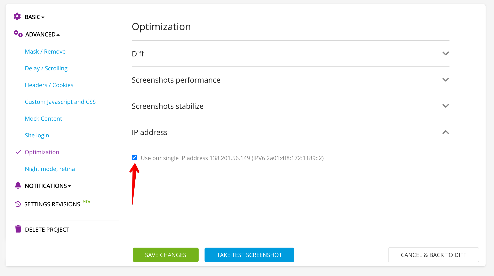

# Bypass protection Cloudfront, Akamai, Incapsula

Sometimes your production environment is protected with an extra security system like a CDN or a Firewall.

Ideally, you can enable a single IP address (138.201.56.149 (IPV6 2a01:4f8:172:1189::2)) in your project settings and allow it in your protection system settings.

But sometimes it is not possible, so more sophisticated methods are needed.

Here are some guides for:

* [Akamai](bypass-akamai-protection.md)
* [Imperva Incapsula](bypass-imperva-incapsula-protection.md)

<figure><figcaption>
Project settings single IP address
</figcaption></figure>

