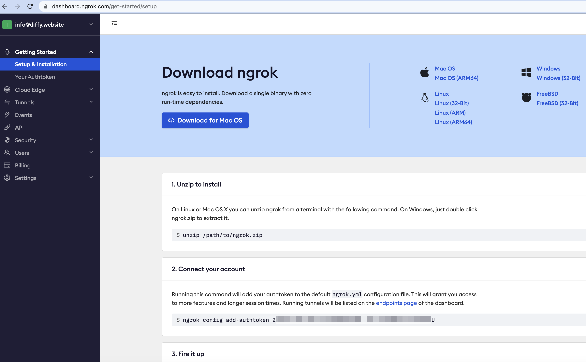
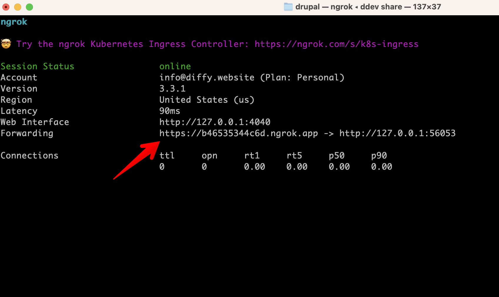

# Ngrok

### Set up ngrok

If you like, I can share with you Diffy's account for testing purposes. Once it works, you can purchase your Personal license yourself.

1. Create an account at https://ngrok.com/ and purchase the license
2. Install ngrok locally (for Mac, it is simple `brew install ngrok`)
3. Populate auth code locally `ngrok config add-authtoken <your token>`

<figure><figcaption>
set up ngrok
</figcaption></figure>

### DDEV setup

Now, you can expose your local site globally by running `ddev share`

For other environments, please check the documentation. Here is an article for [Lando](https://hackernoon.com/lando-wordpress-and-ngrokoh-my). For Docksal similar command `fin share` ([documentation](https://docs.docksal.io/tools/ngrok/)).

<figure><figcaption>
ddev share
</figcaption></figure>

Remember to copy the URL from ngrok.

### Create custom screenshot with Diffy

Now, you can create screenshots from a custom environment. Specify the URL you got from ngrok.

_**Important notice**: We can easily overload your local environment if you set the number of non-production workers to 5._

<figure><figcaption>
custom screenshots from ngrok environment
</figcaption></figure>
